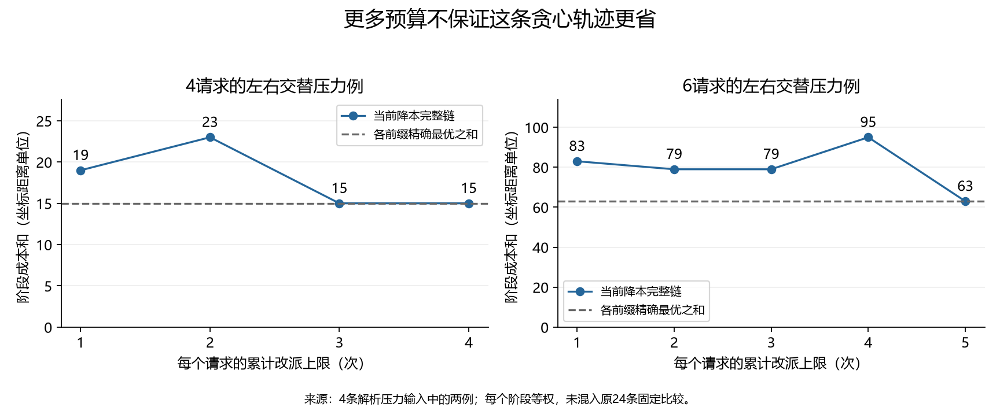
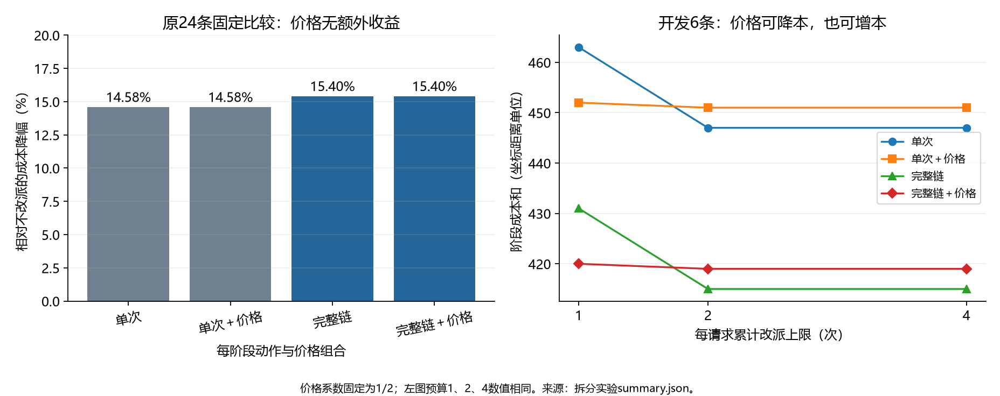

# 有限改派在线匹配：六分支继续研究结果

截至2026-09-28，固定四点布局预算1/2/4的连续精确值为9/3/0。原子批量和单链模型均成立。
预算2的四请求原子模型已补齐显式最优策略与解析证明：通常第二步保留预算，只处理右端例外，最坏累计超额为3。
第1至7节保留原六分支脉络；连续精确值、长序列和文献见第8节；局部策略见第9节；最新显式规则见第10节。新颖性仍未认证。

## 1. 六项任务与交付

|分支|本轮可核验结果|证据与限制|
|---|---|---|
|1. 只允许单链|列出全部四个第二步动作，给连续第三请求上的精确比较程序；出现“原子模型保留、单链模型立即改派”的反例|[链动作与自由首步](链动作与自由首步.md)第2至4节；三个请求、一次预算|
|2. 自由选择首步|给出连续域的完整 `min首步 max第二请求 min第二动作 max第三请求` 决策程序；最近点可严格次优|同报告第5至7节；原子模型、有理数输入精确实现|
|3. 更多请求与预算2/4|证明全前缀精确性最坏需要n−1次；固定四点连续预算1/2/4精确值为9/3/0|[更多请求与策略拆分](更多请求与策略拆分.md)第2节保留历史网格结果；连续域后续见[四请求精确值](四请求精确值.md)|
|4. 链长与价格拆分|完成2×2组合、三个预算的同输入比较，并核查四个价格系数|同报告第3节；系数敏感性仅限原开发6条|
|5. 随机化|证明固定最近首步下，随机化不能改善累计超额；原始成本却有严格改善例，并给双方有理数证书|[随机化与原始成本](随机化与原始成本.md)第3、5、6节；区分对手是否看到抽样|
|6. 原始成本最坏目标|给任意三点前缀的三个闭式候选分数，以及连续随机化的有限线性规划形式|同报告第4至6节；不再只限第二请求位于中间服务点的特例|

原子模型允许同时交换旧请求，更新前后保持唯一占用。单链模型只允许新请求到空点的一条简单增广链。两种模型均逐请求累计改派次数，首次分配免费。累计超额是每阶段实际距离减去该阶段精确最优，再对阶段相加。

## 2. 两项改变策略选择的三点结果

**只允许单链时，首占中间服务点也可能应当提前改派。** 服务点为(0,2,6)，已到请求为(5/4,2)。单链模型立即把首请求移到0，最坏累计超额为5/2；任何保留动作至少为3。原子模型则应保留，最优值为3/2。这是动作范围改变最优时机的严格反例，不是对代码风格的偏好。证据：链报告第3节及其 `strict_timing_reversal_example`。

**最近点不是自由首步下的普遍最优选择。** 服务点为(0,3,6)，首请求为7/4。首占左端点的完整最坏累计超额是1；首占最近的中间服务点为5/2；首占右端点为11/2。所有数都对未知第二、第三请求取了最坏情况，包含第一步付出的超额。证据：链报告第5节及 `first_results`。

本轮用分段线性函数的交点穷尽连续最坏场景。分段线性（Piecewise Linear）表示每小段都为固定斜率的直线。它让原本连续的未来位置变成有限个有证明依据的候选点。程序没有拿密集网格替代连续证明。

## 3. 预算增加，贪心成本可以上升

**新的四请求例中，预算从1增到2让贪心阶段成本和从19升到23。** 两次执行的前缀成本分别为(1,2,8,8)和(1,2,4,16)。多一次预算让算法第三步追随当前最优，却在第四步被先前决策限制。证据：压力输入 `alternating_radius_n4` 的逐步轨迹。

**六请求例中，预算1、2、4的阶段成本和分别为83、79、95。** 预算5时降为63，达到每个前缀精确最优。这个输入来自可证明的左右交替、距离翻倍构造，未混入原24条比较。

证明不依赖这两个具体规模。对任意n，令服务点为s_i=(-1)^i*2^(i−1)，请求依次为0,s_1,...,s_(n−1)。第t步的最优成本为2^(t−1)。任意最优匹配都把首请求0分给与s_t同侧的点，所以它每步必须换点。保持全部前缀精确最优最坏需要n−1次。完整证明见更多请求报告第2节。

**精确优化后的最优值不会因预算增加变差。** 大预算可以模仿小预算策略。在本轮四请求、五个可选坐标的完整在线博弈中，预算1、2、4的最优最坏累计超额为4、2、0。原子与单链模型在该有限域上相同。

2026-09-25细化为13个整数坐标后，预算1、2的有限最优值为9、2。在线取整证明当时给出连续区间上的[9,21]与[2,14]界；预算4为0。网格最大间隔为h时，保证区间宽度不超过12h。2026-09-27的独立连续域求解将精确值确定为9、3、0，未重跑旧网格；预算2说明整数网格值2确实低于连续值3。

## 4. 原比较中的改进来自哪里

**原24条比较中，链长解释了全部10个额外节省单位。** 单旧请求的阶段成本和为1043，完整链为1033。两个动作范围内，价格从0改为1/2都没有改变这组结果。三个预算1、2、4均如此。证据：拆分汇总 `groups[split=eval]`。

**开发集上的价格既可能有益，也可能有害。** 完整链在预算1下加入价格，成本和从431降到420；预算2下却从415升到419。系数0、1/4、1/2、1都已在开发集检查，没有据此重选正式集策略。

这使下一步的研究重点从“多给预算是否更好”转为“新增机会何时应当不用”。证明一个稳健的选择规则，比单纯提高硬上限更直接。

## 5. 随机化收益取决于目标和对手

**在已固定的三点累计超额目标下，随机化没有收益。** 证明为所有候选动作找到同一个最坏未来点，因此不是把各动作分别取最坏后再错误相加。结论覆盖对手看不到抽样结果，以及看见结果再选未来这两种情况。

**原始成本目标下，随机化可能有收益。** 服务点(0,10,50)、已到请求(6,10)中，确定性最优的第二、三阶段成本和最坏为62。以各半概率保留或左移，最坏期望成本为60。对手以2/3、1/3概率选择未来0或6，给出同值下界，因此60是精确最优。

对手必须看不到本次抽样结果。若它先看见实际动作再选未来，最优仍为62。这项结果不能转化为先前累计超额目标的收益。

## 6. 文献取得与缺口

本轮查找了指定题目的多种写法和作者来源，记录28个代表性定向查询。FSTTCS官网确认题名及作者，但页面没有正文链接。本轮没有取得 *Near Optimal Online Bipartite Matching on the Line with Amortized Logarithmic Recourse* 全文，不能推断它尚未公开。[官方目录](https://www.fsttcs.org.in/2026/papers.php)

新增阅读的三篇正文分别研究增量匹配更新时间、动态直线匹配稳定性、层次树上的随机匹配。它们的服务点到达方式或改派计费与本题不同，不能直接套用保证。逐篇原文、页码、读取范围及本地文件见[补充文献核查](补充文献核查.md)。

本轮结论属于独立推导与小规模研究结果。没有确认理论新颖性，也没有把有限输入性能当成一般竞争比。

## 7. 验证与后续边界

拆分实验448条轨迹、2613个在线阶段已独立核验，180条旧算法轨迹与历史结果相同。链与原子三点模型共核对1690项前缀结果，另检查23个自由首步博弈和48项离网格有理数前缀。随机化核对845个前缀、1690次线性规划。四请求的6个较粗网格在线博弈、3个预知未来对照和4个细网格在线博弈由另一实现复算。证据文件见各专题报告。

两次独立数学审阅复核了连续分段覆盖、随机化共同未来证明和压力族的符号强制性。审阅修正了一句单链例的上界说明：应根据最终最优匹配是否属于禁止的交换来选动作，不能对所有未来都保持旧分配。修正没有改变算法或计算结果。

2026-09-25阶段结束时保留三项问题：连续四请求精确值、一般长序列保证、指定FSTTCS正文与新颖性核查。用户随后授权继续处理，最新状态如下。

## 8. 2026-09-27：三项后续工作的结果

### 8.1 连续四请求：精确值已确定

服务点固定为(-4,-1,2,8)，请求属于[-4,8]。首步固定最近点，同分靠左。目标为四阶段累计超额的最坏值。
预算1、2、4的连续精确值分别为 **9、3、0**。完整批量更新与单链动作均成立。

证明先将最后请求的最坏位置精确缩到服务点，再把前三步连续博弈展开为线性实数公式。
单链模型中，预算1/2各四个首步区域的反例公式全部不可满足，给出上界9/3。
原子模型的两份有理数对手树由另一实现枚举全部合法动作，分别保证下界9/3。
原子动作集合包含单链动作集合，因此两端夹住两个模型的最优值。
预算4的零值继续使用已证明的n−1次充分性。

2026-09-27的上界属于精确求解器辅助证明。预算2原子模型后来补齐了解析证明，见第10节；其他上界仍依赖Z3的线性实数判断，未附另一证明内核检查的推导对象。
独立下界核验不导入求解器和生成器。详见[四请求精确值](四请求精确值.md)。

### 8.2 一般长序列：已有明确策略与对数级保证

允许至多b次全局原子重置到当前前缀最优，重置之间运行已知的零改派鲁棒匹配算法。
每请求实际改派至多b次。对任意长度和任意直线布局，每个阶段满足
`C_t ≤ (1+2ρ(n))OPT_t`，其中 `ρ(n)=O(log(n+1))` 是基础算法的已知界。
阈值版本仅在计划成本超过两倍当前最优时考虑使用剩余次数。只要本次开始时尚有次数，实际成本不超过两倍最优。

代码和独立核验器已交付。固定小域覆盖2875条轨迹、8625个前缀；有限核验不代替任意长度的证明。
该构造没有改善零改派的近似阶数，也没有证明一般布局固定预算的常数竞争比。
全局重置不属于只允许一条增广链的模型。完整证明、实现与边界见[长序列低改派保证](长序列低改派保证.md)。

### 8.3 文献：改用五篇可读全文的正式论文

指定FSTTCS稿件的题名、作者和录用日期已重新核对。ESA 2026相关论文补到了正式出版版，其他两篇2026正文的模型也已复核。
指定稿件的公开全文仍未取得，依赖它的重合性判断未完成。用户随后要求绕开该文，重新选择4—5篇可信的前沿参考。
现已选定5篇正式论文：Algorithmica 2025、SODA 2024、ESA 2026、ITCS 2026和ICALP 2025。每篇均已核对正文中的关键结果及模型差异，完整来源与阅读顺序见[五篇全文阅读入口](文献缺口复核_20260927.md#5-当前推荐的五篇论文)。
这完成了新的选篇任务，不等于认证本研究的新颖性。

本轮的数学与代码成果已足够支持上述受限结论。继续增加固定阈值或重复旧实验不值得。
当前阅读不再等待指定稿件。日后取得它的全文时可补做覆盖性核查；一般常数竞争比仍须单独的证明。

### 8.4 整合验证

两项数学结果由另一代理独立审查，并实际运行有效与损坏输入。代理一致不代表外部同行审阅。
仓库完整检查最终退出码为0：756项测试中752项通过、4项条件跳过，58个源码文件的类型检查通过。
首次沙箱内检查在原有后端测试停滞；正常权限重试通过，两次日志均保留。过程和日志入口见[本次继续处理记录](../过程/六分支启动.md#整合检查)。
本轮数据与源码在当前入口可用，尚未提交或远程冻结。

## 9. 2026-09-28：局部冻结与预算复用

**本轮已得到一个不依赖全局重置次数的局部策略，但不替换原策略。**
修正版在9条固定输入、预算1/2/4下的阶段成本和为554/591/514；全局重置为575/563/563，变化分别为−3.65%、+4.97%、−8.70%。
逐序列胜/平/负分别为3/3/3、3/2/4、5/3/1。这些数字只描述固定输入。

方法是让零改派鲁棒匹配算法（RM）决定请求进入哪个预定服务点块，实际只在块内修复。
首轮每块至多4点，预算耗尽后固定该请求。它在已有四请求例的预算2下产生9的冻结损失，触发预定的第二轮修正。
修正版将块大小限制为min(4,b+1)。因此每个请求后续最多再经历b次块内到达，可以始终做块内精确匹配。
实际每个前缀成本都不超过虚拟零改派RM的成本，继承其对数级保证。不同块可以分别调整，整个过程的改派时刻数不再受b限制。

这项保证有两个边界。其一，修正版的冻结不会阻止后续调整，因为最早耗尽预算时块已满；尚未证明自适应冻结能保留未来机会。
其二，预算1/2/4同时对应块大小2/3/4，不能把跨预算差异全部归因于次数。
预算2修正后，冻结损失由9降为0，但分块限制损失由36升为113。这解释了总成本从523升到591。

比较部分90条轨迹、520个前缀通过独立验证。另核验固定六坐标字母表的1296条四请求序列，三个预算共3888条轨迹、15552个前缀，全部通过。
有限字母表上候选最大累计超额为24/30/0，没有达到已知连续最优9/3/0；没有将它当成候选在整个连续域上的精确值。
完整检查757项中753项通过、4项按原条件跳过，58个源码文件的类型检查通过，退出码0。

本轮已达到预定的两次迭代和核验条件。**固定分块方案保留为可复用对照，继续调块大小不值得。**
证明、原始数据、复现入口和限制见[局部冻结与分块修复](局部冻结与分块修复.md)。研究计算合计26.890625 CPU秒，历史正式批次未重跑。

## 10. 2026-09-28：预算2从最优数值变为可执行规则

**固定服务点(-4,-1,2,8)，四请求区间[-4,8]，首步最近且同分靠左。允许原子更新，每请求最多改派两次。**
显式策略通常在第二步保留首请求，给新请求分配最近空点。只有首请求占8且第二请求更靠右时，把首请求移到2并永久固定。
第三、第四步计算当前最优匹配；例外分支保持首请求在2。

已证明：通常分支只有第二步可能产生最多3的超额，后两步均可精确。例外分支固定首请求后，每个后续前缀仍存在全局最优匹配，因而所有阶段都精确。
普通分支前两步不改派，剩余两次到达足够完成每步更新；例外分支首请求只改派一次，其他请求仍最多改派两次。
结合已有固定序列的下界3，得到原子模型预算2的完整构造性解析证明。该保证不再需要未来博弈求解或Z3。

实现仅排序请求并比较最多4个服务点子集。独立核验覆盖6569条序列、26276个前缀，最大累计超额3、单请求最大次数2，研究计算CPU为3.828125秒。
这个策略可能包含旧请求之间的独立交换环，不能直接作为单链模型的策略；没有推广到一般布局或更长序列。
规则、完整证明、两个执行例子及入口见[四请求报告第7节](四请求精确值.md#7-预算2的显式最优策略与解析证明)。

独立数学与行为审查通过，覆盖7条有效序列、2种损坏产物及10个无效到达。仓库完整检查758项中754项通过、4项条件跳过，58个源码文件类型检查通过，退出码0。
本阶段已经足够：最优值3已落实为显式算法和解析证明，按预定条件停止。本次版本收录报告、实现和小型验证样例；完整实验轨迹保留在本地results目录，尚未远程冻结。
